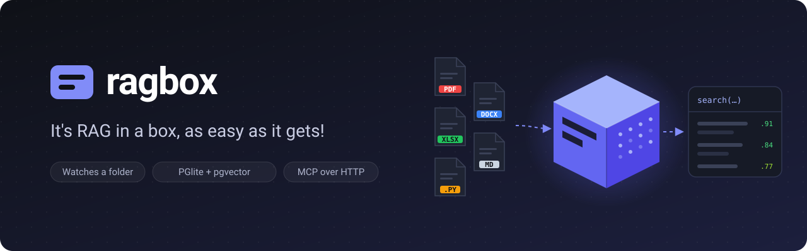

<p align="center">
  
</p>

# ragbox

It's RAG in a box, as easy as it gets!

ragbox is a local retrieval-augmented generation (RAG) service that runs in a
single Docker container. It indexes the files in a folder and lets AI agents
search them through the Model Context Protocol (MCP).

## What ragbox does

- Scans a folder that you mount into the container as read-only.
- Extracts the text from each supported file, splits it into chunks, and
  creates an embedding for each chunk. Embeddings are created by an external
  provider, such as Ollama or any OpenAI-compatible API.
- Stores the chunks and embeddings in [PGlite](https://pglite.dev), an embedded
  PostgreSQL database with the pgvector extension. No separate database is
  required.
- Watches the folder and re-indexes files that are added, changed, or deleted.
  After a file changes, ragbox waits for a cool-down period (10 seconds by
  default) before it re-indexes the file.
- Runs an MCP server over HTTP with one tool, `search`. The tool combines
  vector search with keyword search.
- Serves a web page where you can monitor indexing, see errors, run test
  searches, and change settings.

## Supported files

| Type | Extensions |
| --- | --- |
| Documents | `.pdf`, `.docx`, `.docm`, `.dotx`, `.pptx`, `.pptm`, `.potx`, `.xlsx`, `.xlsm` |
| Text and markup | `.md`, `.markdown`, `.mdx`, `.txt`, `.text`, `.log`, `.rst`, `.html`, `.htm`, `.xhtml` |
| Data | `.csv`, `.tsv`, `.json`, `.jsonc`, `.json5`, `.hujson`, `.geojson`, `.webmanifest`, `.yaml`, `.yml`, `.xml`, `.xsd`, `.xsl`, `.xslt`, `.svg`, `.plist`, `.csproj`, `.pom`, `.ipynb` |
| Source code | `.py`, `.c`, `.h`, `.cpp`, `.cc`, `.hpp`, `.js`, `.jsx`, `.mjs`, `.cjs`, `.ts`, `.tsx`, `.mts`, `.cts`, `.java`, `.cs`, `.go`, `.rs`, `.kt`, `.kts`, `.swift`, `.scala`, `.rb`, `.php`, `.lua`, `.dart`, `.tf`, `.cue`, `.rego`, `.bzl`, `.star`, `.proto`, `.sql`, `.sh`, `.bash`, `.zsh`, `.fish`, `.ps1`, `.bat`, `.cmd`, `.jq` |
| Files without an extension | `Dockerfile`, `Containerfile`, `Makefile`, `Tiltfile`, `BUILD`, `BUILD.bazel` |

MetaTrader files (`.mq4`, `.mqh`) are also supported but are disabled by
default. You can enable or disable any file type on the **Settings** page.

PDF files must contain a text layer. ragbox doesn't run OCR on scanned
documents.

## Run ragbox

Before you begin, install [Docker](https://docs.docker.com/get-docker/) and
[Ollama](https://ollama.com).

1. Download an embedding model:

   ```bash
   ollama pull embeddinggemma
   ```

1. Clone the repository:

   ```bash
   git clone https://github.com/ferraridavide/ragbox.git
   cd ragbox
   ```

1. Start ragbox. Replace `/path/to/your/documents` with the folder that you
   want to index:

   ```bash
   RAGBOX_DOCS=/path/to/your/documents docker compose up -d --build
   ```

1. Open <http://localhost:8080> to see the indexing progress.

## Connect an MCP client

The MCP endpoint is `http://localhost:8080/mcp`. It uses the Streamable HTTP
transport.

To add ragbox to Claude Code, run the following command:

```bash
claude mcp add --transport http ragbox http://localhost:8080/mcp
```

For clients that use a JSON configuration file, add the following entry:

```json
{
  "mcpServers": {
    "ragbox": { "type": "http", "url": "http://localhost:8080/mcp" }
  }
}
```

The `search` tool accepts the following arguments:

| Argument | Required | Description |
| --- | --- | --- |
| `query` | Yes | The text to search for. |
| `limit` | No | The maximum number of results, from 1 to 50. The default is 8. |
| `path_prefix` | No | Searches only the files in this folder, for example `projects/acme/`. |

## Configure ragbox

You can change all settings on the **Settings** page of the web interface.
To set initial values, use environment variables in `docker-compose.yml`.
Values that you save in the web interface take precedence over environment
variables.

| Variable | Default | Description |
| --- | --- | --- |
| `RAGBOX_EMBEDDING_PROVIDER` | `ollama` | `ollama` or `openai`. Use `openai` for any OpenAI-compatible API. |
| `RAGBOX_EMBEDDING_URL` | `http://host.docker.internal:11434` | The URL of the embedding provider. For `openai`, include the API version, for example `https://api.openai.com/v1`. |
| `RAGBOX_EMBEDDING_MODEL` | `embeddinggemma` | The embedding model. |
| `RAGBOX_EMBEDDING_API_KEY` | None | The API key for the embedding provider. |
| `RAGBOX_COOLDOWN_SECONDS` | `10` | The number of seconds to wait after a file changes before ragbox re-indexes it. |
| `RAGBOX_MCP_TOKEN` | None | If set, MCP clients must send the header `Authorization: Bearer <token>`. |

Every other setting on the **Settings** page can be set in the same way. The
variable name is `RAGBOX_` followed by the setting name in upper snake case.
For example, `chunkSize` becomes `RAGBOX_CHUNK_SIZE`.

If you change the embedding model, ragbox rebuilds the index.

## Limitations

- The web interface doesn't have authentication. By default,
  `docker-compose.yml` makes ragbox available only on `127.0.0.1`.
- Run only one ragbox container for each data volume.
- On Linux, the container runs as user ID 1000. That user must be able to read
  the mounted folder.

## Development

To run ragbox without Docker, you need Node.js 22 or later.

```bash
npm install
RAGBOX_DOCS_DIR=./docs RAGBOX_DATA_DIR=./data RAGBOX_EMBEDDING_URL=http://localhost:11434 npm run dev
npm test
```

## License

ragbox is licensed under the MIT License. Parts of the file parsing and
chunking code are adapted from
[knowledge-rag](https://github.com/lyonzin/knowledge-rag), which is also
licensed under the MIT License. For details, see [LICENSE](LICENSE).
